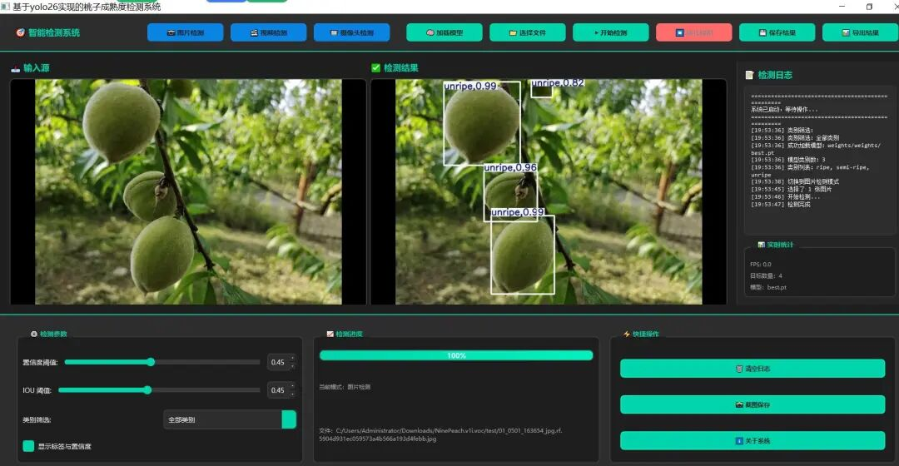
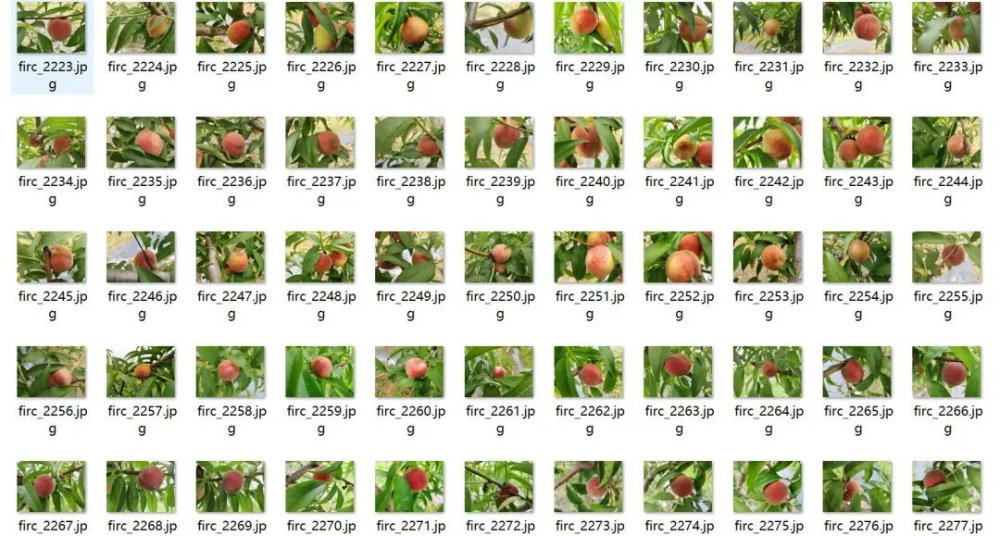
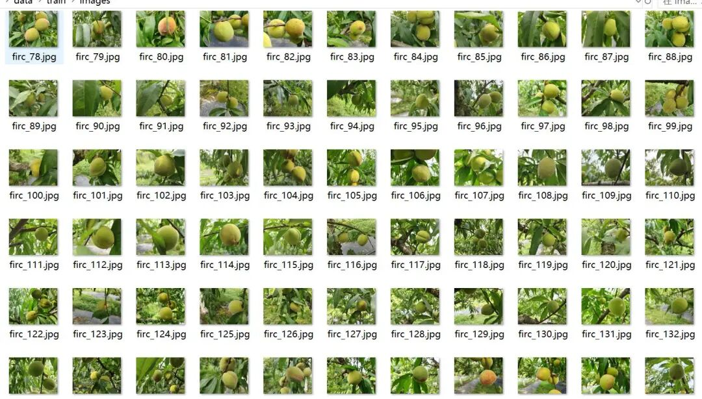
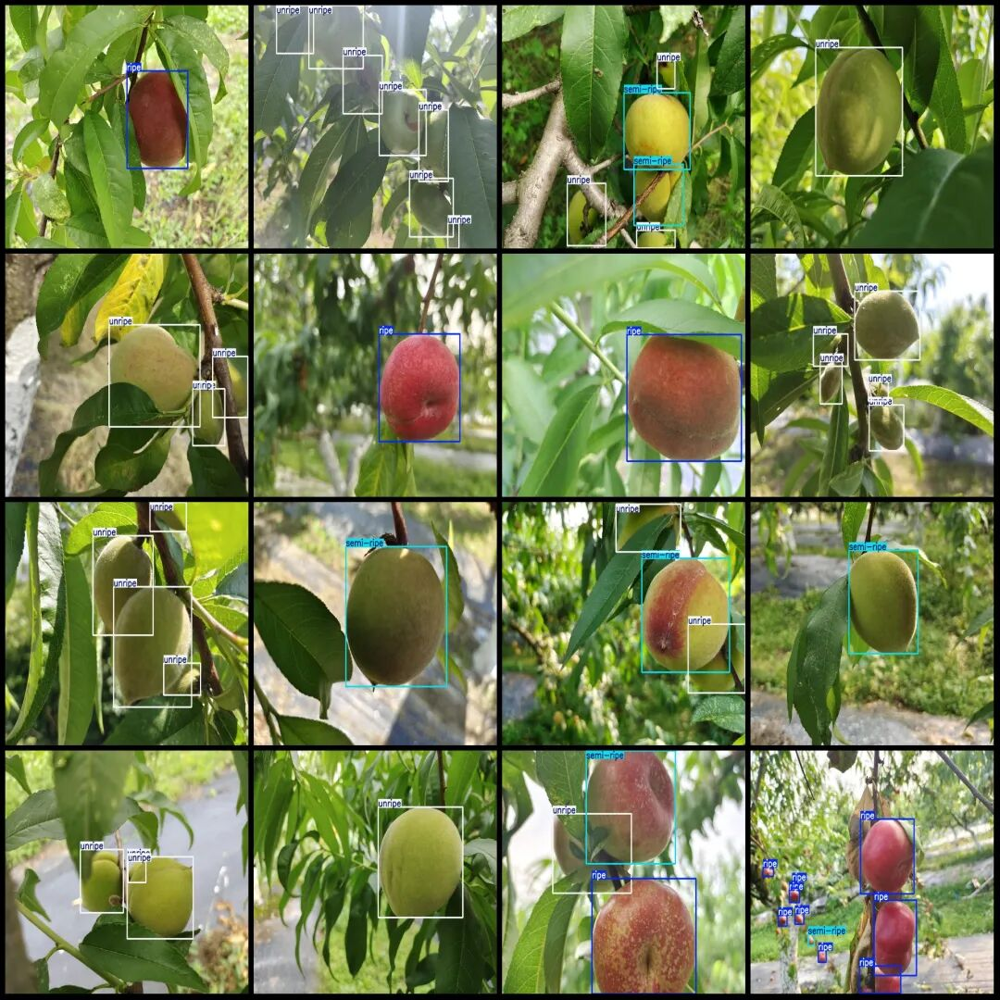

# Peach Maturity Detection System Based on Yolov26 Python Source Code + PyTorch Model + Evaluation Indicator Curve + High-quality GUI Interface

A desktop application based on PyQt5 and YOLO26 for object detection, supporting real-time detection of images, videos, and cameras.

### Functional Characteristics

-

• **Image Detection**: Supports image detection.

-

• **Video Detection**: Supports real-time detection and playback of video files.

-

• **Camera Detection**: Supports real-time camera video stream detection.

-

• **Model Switching**: Supports loading different YOLO26 models (.pt or .onnx format)

-

• **Parameter Adjustment**: Adjustable confidence threshold and IOU threshold

-

• **Category Filtering**: Supports filtering results by category.

-

• **Result Export**: Supports saving the detection results as images or exporting them in JSON/TXT format.

-

• **Real-time Statistics**: Displays real-time statistics such as FPS, target count, etc.

---

### Effect Display



Insert image description here.

### Training dataset introduction

Dataset format: YOLO format (txt file without split path, only containing jpg images and corresponding yolo format txt files)
Number of images (number of jpg files): 3630
Number of annotations (number of txt files): 3630
Training set size: 2333
Validation set size: 200
Test set size: 1097
Number of annotation categories: 3
Annotation category names (note that the order in yolo format does not correspond to this, but is based on the labels folder classes.txt): ['ripe', 'semi-ripe', 'unripe']
Number of bounding boxes per category:
Ripe bounding box count = 1763
Semi-ripe bounding box count = 3676
Unripe bounding box count = 5168
Total bounding box count = 10607
Labeling tool used: labelImg
Annotation rules: Draw a rectangle around the category
Important note: No guarantees are made regarding the accuracy of the trained model or weight files.
Image preview:



Insert image description here.



Insert image description here.

Annotation example:



Insert image description here.

### Training Status Introduction

The model was trained on 2333 training images plus 200 validation images.

|

Class

 ||

Images

 ||

Instances

 ||

P

 ||

R

 ||

mAP50

 ||

mAP50-95

 |

|

all

 ||

200

 ||

613

 ||

0.726

 ||

0.790

 ||

0.822

 ||

0.737

 |
|

ripe

 ||

47

 ||

84

 ||

0.884

 ||

0.813

 ||

0.894

 ||

0.821

 |
|

semi-ripe

 ||

102

 ||

213

 ||

0.619

 ||

0.739

 ||

0.753

 ||

0.678

 |
|

unripe

 ||

113

 ||

316

 ||

0.676

 ||

0.816

 ||

0.818

 ||

0.711

 |

## Algorithm Principles

YOLO26 Object Detection Algorithm

This project is based on the **YOLO26 (You Only Look Once v26)** object detection algorithm, developed by Ultralytics. YOLO26 is a one-stage (One-Stage) object detector characterized by the following features:

1. Network Architecture

YOLO26 adopts advanced backbone network and feature fusion network:

-

• **Backbone**: Utilizes the C3k2_HGBlock structure, improved from PPHGNetV2, integrating HGBlock's dense connection and compression incentive mechanism. Coupled with LightConv, it reduces computational load while enhancing feature extraction efficiency, meeting the lightweight requirements of edge devices.

-

• **Neck**: Utilizes PAN-FPN (Path Aggregation Network - Feature Pyramid Network) structure to achieve top-down and bottom-up feature fusion.

-

• **Head**: Decoupled Head design, which separates the classification and positioning tasks for processing, enhances detection accuracy.

2. Testing Process

1.

1. **Image Preprocessing**: Adjust the input image to the model input size (default 640x640), and perform normalization processing.

1.

2. **Feature Extraction**: Extract multi-scale feature maps through the Backbone network.

1.

3. **Feature Fusion**: The Neck network integrates features from different levels to enhance the detection capability of small targets.

1.

4. **Predicted Output**: The Head network outputs the category probability and bounding box coordinates for each grid.

1.

5. **Post-processing**: No need for the NMS (Non-Maximum Suppression) algorithm; the model is designed end-to-end, directly outputting the final detection results, simplifying deployment processes and reducing inference latency.

3. Key Technologies

-

• **Anchor-Free Detection**: YOLO26 adopts an anchor-free design, directly predicting the center point and size of the target, simplifying the model structure.

-

• **Dynamic Target Alignment (DTA)**: Replaces the traditional Task-Aligned Assigner, assigning unique positive sample grids to each target during training, fundamentally avoiding the generation of duplicate boxes and supporting end-to-end designs without NMS.

-

• **No DFL Design**: Abandoning the complex distribution modeling of traditional DFL (Distribution Focal Loss), adopts lightweight direct coordinate regression to reduce inference burden and enhance edge device operational speed.

-

• **Mosaic Enhancement**: During training, employ Mosaic data augmentation to stitch four images together, enhancing the capability for small object detection.

-

• **End-to-end No NMS Design**: YOLO26 eliminates the traditional post-processing steps of NMS by optimizing prediction generation and training processes, allowing the model to directly output final detection results without the need for additional filtering of duplicate boxes. This not only enhances inference speed but also simplifies deployment on multi-hardware platforms.

4. Post-processing algorithms

-

• **Confidence Filter**: Filter out detection results with a confidence score below the threshold.

-

• **Category Filtering**: Supports filtering results based on specified categories.

### Environmental Requirements

#### Hardware Requirements

|

Project

 ||

Minimum Configuration

 ||

Recommended configuration

 |

|

CPU

 ||

Intel i5 or equivalent performance

 ||

Intel i7/i9 or AMD Ryzen 7/9

 |
|

Memory

 ||

8 GB

 ||

16 GB or above

 |
|

Graphics card

 ||

Supports CUDA-enabled NVIDIA GPU (optional)

 ||

NVIDIA RTX 1660 or above

 |
|

VRAM

 ||

4 GB (GPU inference)

 ||

8 GB or above

 |
|

Hard drive

 ||

2 GB available space

 ||

SSD, 5 GB available space

 |

#### Software Environment

-

• **Operating System**: Windows 10/11, Linux, macOS

-

• Python: 3.9 or above

-

• **CUDA**: 11.8 or above (if GPU acceleration is required)

-

• **cuDNN**: 8.6 or above (if GPU acceleration is required)

---

### Installation Steps

#### 1. Clone or download the project

```
# Use git clone
git clone <project repository address>
# or directly download the ZIP archive and extract it.
```

#### 2. Create a virtual environment (recommended)

```
# Using conda to create
conda create -n YOLO26-det python=3.9
conda activate YOLO26-det
# or use venv to create
python -m venv venv
# Windows:
venv\Scripts\activate
# Linux/Mac:
source venv/bin/activate
```

#### 3. Install Dependencies

```
# Install PyTorch (select according to CUDA version)
# CUDA 11.8 version:
pip install torch==2.0.1+cu118 torchvision==0.15.2+cu118 --extra-index-url https://download.pytorch.org/whl/cu118
# CUDA 12.1 version:
pip install torch==2.0.1+cu121 torchvision==0.15.2+cu121 --extra-index-url https://download.pytorch.org/whl/cu121
# CPU Version (without graphics card):
pip install torch==2.0.1 torchvision==0.15.2 --extra-index-url https://download.pytorch.org/whl/cpu
# Install other dependencies
pip install ultralytics==8.4.31
pip install PyQt5==5.15.9
pip install opencv-python==4.8.0.74
pip install numpy==1.24.3
```

4. Preparing Model Files

Place the trained YOLO26 model file (.pt format) in the `weights/` directory:

```
weights/
├── best.pt  # Main model file
├── class_names.txt  # Class names file
└── ...
```

**Category Name File Format** (class_names.txt):

```
ripe
semi-ripe
unripe
```

Each line represents a category name, and the order must match the category order during model training.

---

### Running Steps

#### Starting the Application

```
# After activation of the virtual environment
python main.py
```

#### Usage Process

1.

1. **Load the model**:

-

• The default model will be automatically loaded when the program starts by loading it from the `weights/` directory.

-

• or click the "Load Model" button to manually select the model file.

1.

2. Select the detection mode:

-

• **Image Detection**: Click the "Image Detection" button, then select "Select File" to load an image.

-

• **Video Detection**: Click the "Video Detection" button, select a video file.

-

• **Camera Detection**: Click the "Camera Detection" button to automatically open the default camera.

1.

3. **Set parameters** (optional):

-

• Adjust "Confidence Threshold": Control the lower bound of confidence for detection results (0.1 - 0.9)

-

• Adjust "IOU Threshold": Control the overlap threshold of non-maximum suppression (0.1 - 0.9)

-

• Select "Category Filter": Only display the results for the specified category.

-

• Check "Display Labels and Confidence": Control whether labels are displayed on the image.

1.

4. **Start Detection**:

-

• Click the "Start Detection" button to initiate the detection.

-

• The process can be stopped by clicking "Stop Detection" during the detection.

1.

5. **Save the results**:

-

• Click "Save Results" to save the result image.

-

• Click "Export Results" to export detection data as JSON or TXT format.

-

• Click "Screenshot Save" to quickly save the current screen.

---

### Notes

1. Model files

-

• Ensure that the model file (.pt) matches the class name file (class_names.txt)

-

• The model file path cannot contain Chinese characters. It is recommended to place it under the `weights/` folder in the project root directory.

-

• Supported model formats: PyTorch (.pt) and ONNX (.onnx)

2. GPU acceleration

-

• The first run will automatically download the pre-trained weights related to CUDA, which may take a few minutes.

-

• If you encounter the CUDA memory shortage error, please close other programs that use the video memory.

-

• Without NVIDIA graphics card, the program will switch to CPU inference automatically, which is slower.

#### 3. Test parameters

-

• **Confidence Threshold**: It is recommended to set it between 0.3 and 0.5, as setting it too low may result in a large number of false positives, while setting it too high may lead to missed detections.

-

• **IOU threshold**: Suggest setting between 0.4 - 0.6 for removing overlapping detection boxes

-

• Parameter adjustments will take effect immediately without the need to re-load the model.

4. Camera detection

-

• Ensure that the camera device is functioning properly and not occupied by other programs.

-

• Default to using camera index 0, if you need to modify, please adjust the `camera_index` parameter in the code.

-

• The camera is in real-time mode. To exit, press "Stop Detection" or close the window.

5. Performance Optimization

-

• When video detection is performed, the detection speed depends on the video resolution and graphics card performance.

-

• If there is a lag, try to reduce the input video resolution or replace the more powerful graphics card.

-

• When processing a batch of images, they will be processed in sequence. It is recommended to ensure sufficient disk space before processing a large number of images.

6. Common Issues

|

Question

 ||

Solution

 |

|

Model loading failed

 ||

Check if the model file path is correct and ensure that the file is not corrupted.

 |
|

Unable to open the camera

 ||

Check the camera connection and ensure that no other programs are using the camera.

 |
|

CUDA out of memory

 ||

Reduce the batch size, close other programs, or use CPU inference.

 |
|

The test results are inaccurate.

 ||

Adjust the confidence and IOU thresholds, or replace with a more suitable model.

 |
|

Interface display abnormality

 ||

Ensure PyQt5 is correctly installed and try updating the graphics driver.

 |

---

### Folder Structure

```
YOLO26-det-pyqt5/ # Project root directory
│
├── main.py                   # Main program entry point, PyQt5 interface implementation
├── Yolov26Detector.py  # Core class for the YOLO26 detector
├── README.md  # Project Description Document
│
├── weights/  # Model weight folder
├── weights/  # Subfolder (holds .pt model files)
└── best.pt  # Default model file
├── class_names.txt  # List of category names
├── args.yaml # Training parameter configuration
├── data.yaml
├── results.csv  # Training result data
├── results.png # Training result chart
├── confusion_matrix.png # Confusion matrix
├── BoxF1_curve.png # F1 score curve
├── BoxP_curve.png # Accuracy Curve
├── BoxR_curve.png # Recall rate curve
└── ... # Other training and validation visualization results
│
├── test_img/  # Test image folder
├── firc_1000.jpg # Test image example
│   ├── firc_1001.jpg
└── ...
│
└── Dataset Address.xlsx  # Dataset Information Document
```

#### File Description

|

File/Folder

 ||

Notes

 |

| `main.py` ||

Application main entry point, including PyQt5 GUI interface, multi-thread detection logic, and signal-slot handling.

 |
| `Yolov26Detector.py` ||

YOLO26 detection core class, encapsulates model loading, inference, and visualization functionalities.

 |
| `weights/` ||

Stores the model weights file and related configurations, which are the core resource directory for detection functionality.

 |
| `test_img/` ||

Provide test example images for quick verification of detection functions.

 |
| `class_names.txt` ||

Category name definition file, each line represents a category, and the order must match the model training.

 |
| `data.yaml` ||

YOLO26 dataset configuration file, including the number of categories, category names, and dataset path

 |

---

### Technology Stack

-

• **Python 3.9+**: programming language

-

• PyQt5: Desktop GUI framework

-

• **YOLO26 (Ultralytics)**: Object Detection Model

-

• **OpenCV**: Image and Video Processing

-

• **NumPy**: Numerical Computation

-

• PyTorch: Deep Learning Framework

---

### License Agreement

This project is for learning and research purposes only.

---

### Update Log

#### v1.0

-

• Initial version release

-

• Supports three detection modes: image, video, and camera.

-

• Implement parameter adjustment and result export functions

-

• Provide real-time FPS and statistical information display


## Payment

Here is a pay link on Stripe ( https://buy.stripe.com/3cs8yP7sY87d0vu9AB ). Please contact me lonlonago@foxmail.com after funding $89, and I will send you a complete data files , thank you!


